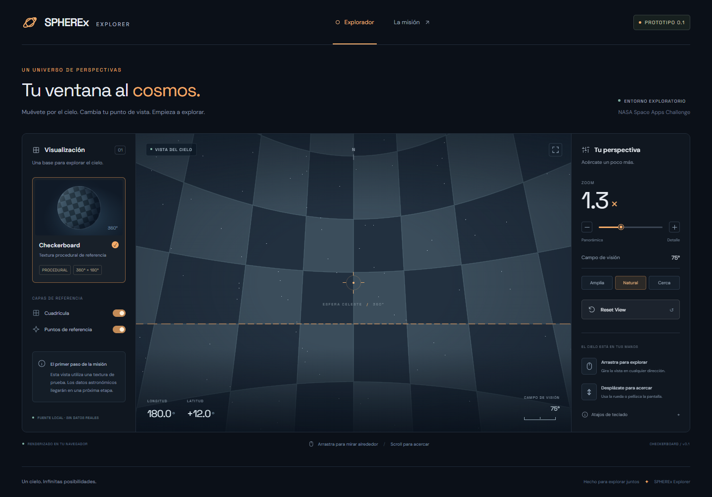

# SPHEREx Explorer

Repositorio del equipo: [Chompin003/spherex-explorer](https://github.com/Chompin003/spherex-explorer).

**Explorador público:** [spherex-explorer.pages.dev](https://spherex-explorer.pages.dev/).

Prototipo web para NASA Space Apps Challenge: una esfera celeste 3D con checkerboard procedural, navegación desde su interior y controles accesibles. No contiene imágenes ni datos científicos reales y no es un producto oficial de NASA.

La interfaz ocupa toda la pantalla. La flecha de la esquina abre una ventana flotante para zoom, fecha e intervalo de reproducción. Arrastra su barra para moverla o sus bordes para redimensionarla. El zoom va de 100° a 1″. Coordenadas J2000 y Paint tienen slots preparados para los módulos de otros integrantes. Las fechas actuales son de prueba; el checkerboard permanece fijo.

Referencias y decisiones: [WISE View, el documento del equipo y los recursos del challenge](docs/REFERENCIAS-VISOR.md).

## Desarrollo local

Requiere Node.js 24 LTS, npm y Git.

```sh
npm ci
npm run dev
```

Abre la dirección que imprime Vite. `npm run dev -- --host 0.0.0.0` permite probar en un teléfono de tu red local.

```sh
npm run check
npm test
npm run build
npm run preview
```

## Equipo

Lee [la guía de colaboración](docs/COLABORACION.md), [los contratos de módulos](docs/ARQUITECTURA.md) y [AGENTS.md](AGENTS.md). Cada desarrollador usa su computadora, cuenta y sesión de IA. Live Share sirve para sesiones conjuntas; Git y Pull Requests integran el trabajo independiente.

| Rama                 | Responsabilidad                    |
| -------------------- | ---------------------------------- |
| `main`               | Versión integrada para producción  |
| `feat/sky-viewer`    | Esfera, cámara, controles y WebGL  |
| `feat/spherex-data`  | Proveedores de datos y coordenadas |
| `feat/drawing-tools` | Selección y futuras anotaciones    |
| `feat/interface`     | Interfaz, controles y estilos      |

## Despliegue

Los colaboradores hacen push a su rama: **Auto integrate** crea/actualiza el PR y lo integra cuando pasan `quality` y `Cloudflare Pages`. No se exige aprobación humana. La página pública conserva la misma URL. Los fallos de tests o conflictos detienen la integración.

Cloudflare Pages: `main`, `npm run build`, salida `dist`, Node `24.11.1`. Configuración y verificación en [docs/DESPLIEGUE.md](docs/DESPLIEGUE.md). La existencia de los archivos de CI no confirma que un despliegue remoto se haya ejecutado; comprueba los estados en GitHub y Cloudflare.

Tecnologías: React, TypeScript, Vite y Three.js. Licencia MIT.

El [entorno Python de astronomía](tools/astronomy/README.md) incluye Astroquery y herramientas FITS/PNG. Todavía no hay datos reales conectados al visor.

Consulta el [estado de la entrega y las autorizaciones pendientes](docs/ESTADO.md).


