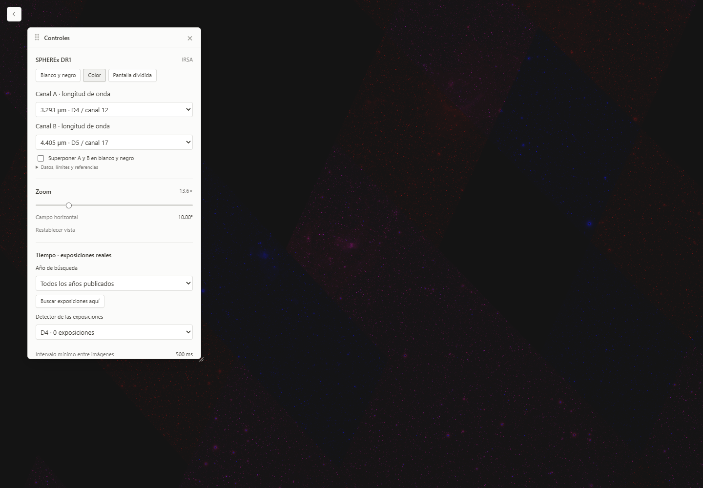

# SPHEREx Explorer

Repositorio del equipo: [Chompin003/spherex-explorer](https://github.com/Chompin003/spherex-explorer).

**Explorador público:** [spherex-explorer.pages.dev](https://spherex-explorer.pages.dev/).

Explorador educativo de imágenes reales de NASA/SPHEREx servidas por Caltech/IPAC IRSA. No es un producto oficial de NASA.

Visor a pantalla completa y una sola flecha para abrir una ventana móvil/redimensionable. Incluye coordenadas RA h:m:s / Dec ±d:m:s, 100 canales útiles del mosaico DR1, superposición de dos canales, B/N, color falso y pantalla dividida sincronizada. La búsqueda de exposiciones por coordenadas permite recorrer fechas reales con año, hora UTC y reproducción regulable. Paint conserva su slot para el equipo.

El mosaico mezcla fechas y tiene muestreo aproximado de 12.88″/píxel; ampliar hasta 1″ no añade resolución. Las exposiciones individuales se obtienen como recortes FITS de 0.1° y se corrigen para visualización usando su WCS/SIP. Las longitudes de onda de un detector pueden variar entre exposiciones: el parpadeo no constituye una medición fotométrica a longitud de onda fija.

[Cómo funciona, qué se usó del documento y evaluación de Astroquery](docs/COMO-FUNCIONA.md). [Licencias y procedencia](docs/THIRD-PARTY.md).

## Desarrollo local

Requiere Node.js 24 LTS, npm y Git.

```sh
npm ci
npm run dev:full
```

Abre la dirección que imprime Wrangler (puerto 8788). Este comando construye y sirve frontend + Functions. `npm run dev` conserva Vite con recarga rápida para cambios de interfaz, sin los endpoints de exposiciones.

```sh
npm run check
npm test
npm run build
npm run preview
```

## Equipo

Lee [la guía de colaboración](docs/COLABORACION.md), [los contratos de módulos](docs/ARQUITECTURA.md) y [AGENTS.md](AGENTS.md). Cada desarrollador usa su computadora, cuenta y sesión de IA. Live Share sirve para sesiones conjuntas; Git y Pull Requests integran el trabajo independiente.

| Rama                 | Responsabilidad                    |
| -------------------- | ---------------------------------- |
| `main`               | Versión integrada para producción  |
| `feat/sky-viewer`    | Esfera, cámara, controles y WebGL  |
| `feat/spherex-data`  | Proveedores de datos y coordenadas |
| `feat/drawing-tools` | Selección y futuras anotaciones    |
| `feat/interface`     | Interfaz, controles y estilos      |

## Despliegue

Los colaboradores hacen push a su rama: **Auto integrate** crea/actualiza el PR y lo integra cuando pasan `quality` y `Cloudflare Pages`. No se exige aprobación humana. La página pública conserva la misma URL. Los fallos de tests o conflictos detienen la integración.

Cloudflare Pages: `main`, `npm run build`, salida `dist`, Node `24.11.1`. Configuración y verificación en [docs/DESPLIEGUE.md](docs/DESPLIEGUE.md). La existencia de los archivos de CI no confirma que un despliegue remoto se haya ejecutado; comprueba los estados en GitHub y Cloudflare.

Tecnologías: React, TypeScript, Vite, Aladin Lite (CDS) y Pages Functions. Three.js se conserva como referencia de desarrollo. Código de la aplicación MIT; Aladin LGPL-3.0-or-later.

El [entorno Python de astronomía](tools/astronomy/README.md) incluye Astroquery y herramientas FITS/PNG. El script `query_spherex.py --verify-first` consulta exposiciones reales y contrasta el recorte con Astropy; el runtime web usa SIA/HiPS directamente.

Consulta el [estado de la entrega](docs/ESTADO.md).


