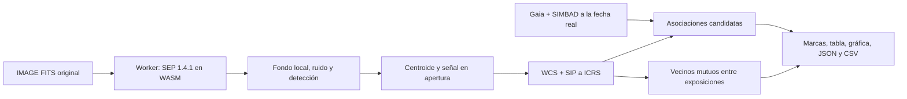
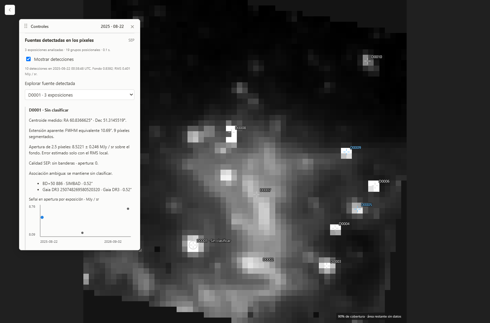

# Detección sobre píxeles y evolución entre exposiciones

Coordinación previa: se integrará SEP (Source Extraction and Photometry, LGPL-3.0-or-later) compilado a WebAssembly en un Web Worker. Se analizarán los IMAGE FITS originales, con máscara y WCS/SIP preservadas; los resultados incluirán centroides, morfología, señal y banderas. Las asociaciones con catálogos se distinguirán de detecciones y se mantendrán ambiguas cuando corresponda. La evolución temporal se basará en detecciones por exposición, sin interpretar cambios de longitud de onda como variabilidad física.

shared contendrá contratos de PixelStudy, detecciones, asociaciones y mediciones; viewer expondrá un análisis asíncrono de una secuencia FITS por su API pública. App compondrá esa función con StudyPanel y las marcas de data, sin importaciones entre módulos. Se conservarán ViewState, coordinateTools, drawingTools y los archivos científicos. El análisis será explícito, cancelable, fuera del hilo principal y con límites de cuadros/memoria; no se activarán servicios pagados ni se publicará un modelo sin evaluación.

Para permitir una comprobación funcional cuando el archivo externo esté caído, se añadirá un conjunto real de ejemplo NGC 1491: tres IMAGE FITS oficiales, tablas reales de catálogo y manifiesto con fechas, URLs originales y hashes. Se abre solo por acción explícita y se identifica como ejemplo guardado; nunca se usará como sustituto de una consulta fallida. El estado URL tendrá un identificador de conjunto validado y el trabajador solo admitirá sus tres rutas locales conocidas. App coordinará apertura, restauración y resultados con ObservationsPanel/StudyPanel.

## Implementación entregada

**Estudiar región → Interpretar región** consulta Gaia/SIMBAD y, cuando hay una secuencia FITS activa, detecta grupos de emisión en los píxeles originales de cada exposición. Para comprobarlo sin depender del archivo externo: **Abrir ejemplo real NGC 1491**, después **Interpretar región**. El ejemplo tiene tres exposiciones oficiales de 2025–2026 y se identifica claramente como guardado. Su manifiesto público conserva procedencia, fechas y hashes; un fallo de una consulta normal nunca lo activa.



SEP es la biblioteca abierta de extracción de fuentes, compilada a WebAssembly con Emscripten 4.0.23. También aparece en las herramientas oficiales de descubrimiento SPHEREx de IPAC: [demostración](https://caltech-ipac.github.io/irsa-tutorials/spherex-source-discovery-tool-demo/), [fuentes de SEP](https://github.com/sep-developers/sep/tree/v1.4.1). No se entrenó un modelo nuevo. El análisis corre en un Worker independiente y cancelable; la animación mantiene su caché y Canvas sin esperar a SEP.

## Qué se mide

- Fondo y RMS locales con malla de hasta 32×32 píxeles y filtro de mediana de tres celdas; se enmascaran valores inválidos.
- Extracción con filtro 3×3, área mínima de cinco píxeles y umbral ajustable 3–10σ (5σ inicial). Se conservan grupos de emisión conectada: no se separan mezclas no resueltas.
- Centroide, ejes de segundo momento, área, pico sobre fondo y FWHM equivalente aparente. La transformación directa TAN-SIP convierte el centroide a ICRS sin analizar la imagen interpolada de pantalla.
- Promedio sobre el fondo en apertura circular de radio 2.5 píxeles y error del promedio a partir del RMS local. La unidad se lee íntegra de `BUNIT` (MJy / sr en los ejemplos). No es flujo integrado calibrado ni incertidumbre instrumental completa.
- Candidaturas Gaia/SIMBAD dentro de 6.15″, después de propagar movimiento propio disponible a la fecha. Varias contrapartes o una reclamada por varias detecciones permanecen ambiguas/sin clasificar. Una coincidencia única tampoco confirma identidad.
- Enlace temporal de vecinos más cercanos mutuos dentro de 6.15″, con margen de 1.5″ respecto al siguiente candidato. No se cruza una exposición fallida o vacía. Las marcas siguen exclusivamente centroides medidos en la fecha visible; no se inventan posiciones intermedias ni se demuestra movimiento físico.

Seleccionar un grupo abre sus mediciones por fecha. Los puntos de la gráfica y los botones de la tabla abren la exposición correspondiente y pausan la reproducción. JSON incluye región, parámetros, origen de cada FITS, tiempos, fallos y candidaturas; CSV permite trabajar con las mediciones fuera del visor.

## Límites científicos y operativos

Solo se analiza IMAGE. No se aplica el mapa instrumental FLAGS ni VARIANCE, corrección de apertura o PSF, ni la tabla WCS-WAVE del archivo completo. Las banderas presentadas son de SEP. Las exposiciones pueden tener longitudes de onda distintas: la gráfica **no es una curva de luz a banda fija ni un espectro**. Tampoco identifica toda emisión difusa o todas las fuentes débiles. Gaia DSC aporta clases publicadas, sin validar su precisión sobre SPHEREx.

Hasta 96 exposiciones, 262,144 píxeles y 500 detecciones por recorte; resultados parciales y fallos explícitos. Se incluyen la fecha activa y hasta 96 fechas ordenadas; se detiene la descarga tras tres fallos de red consecutivos o 180 s. Solo admite `/api/cutout` del sitio y los tres FITS conocidos del ejemplo. No hay Python público, servicio de pago o entrenamiento nocturno. Consultas en vivo siguen dependiendo de IRSA; los fallos externos no se ocultan.

## Comprobación reproducible

`npm test` verifica SEP/WASM frente a SEP 1.4.1 de Python y WCS Astropy, con FITS oficiales: centroides, geometría, fondo/RMS, apertura/error, banderas, coordenadas y bytes originales. El generador independiente es `tools/astronomy/verify_sep.py`. Los tres recortes completos producen 11, 7 y 6 grupos; en el cuadrado de 0.1° del ejemplo quedan 10, 5 y 6.

Las pruebas de navegador cubren detección real, exportación, selección de fecha, coordenadas/URL, Paint, cancelación/reinicio, fecha FITS incorrecta y ausencia de sustitución automática ante un fallo del archivo.

Con el sitio local compilado en el puerto 4174:

```powershell
node scripts/measure-pixels.mjs
```

Se bloquearon los archivos externos y se usaron los datos reales guardados. La medición en esta computadora (`pixel-performance.json`) dio 305 ms de análisis completo desde la interfaz, 90 ms en el Worker, 21 detecciones y un grupo enlazado en las tres fechas. Treinta presentaciones a intervalo 100 ms: mediana 99.9 ms, p95 117.3 ms, cero solicitudes FITS nuevas y cero documentos de visor adicionales. Es una medición local, no garantía para cualquier región o dispositivo.



## Contratos y mantenimiento

`shared/pixels.ts` contiene resultados y solicitudes; `shared/pixelAssociations.ts` contiene asociaciones y enlaces. `viewer/analyzePixels` es la API asíncrona pública. `App` la inyecta en `StudyPanel` y monta `DetectionMarkers`; `ObservationsPanel` recibe solicitudes de fecha. Se conservan `coordinateTools`, `drawingTools` y ViewState en grados. La reconstrucción de SEP y las licencias están en `public/vendor/sep/SOURCE.md`.
