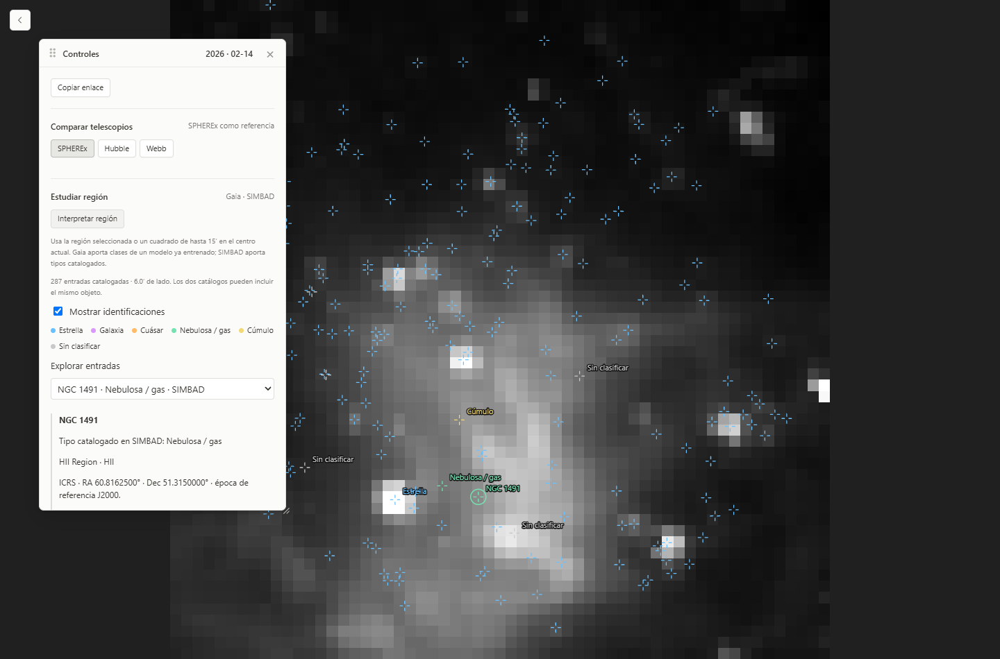
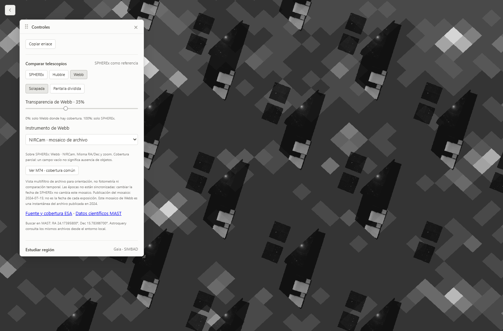

# Enlaces, comparación y estudio de regiones

Implementación coordinada en [PR #15](https://github.com/Chompin003/eon/pull/15).

**Copiar enlace** guarda ICRS `ra`, `dec`, FOV horizontal `fov`, bandas, presentación, comparación y transparencia. En una región temporal incluye el identificador `epoch` y el centro/tamaño. Al abrirlo, consulta metadata real IRSA para recuperar esa exposición y la deja pausada; si no existe, muestra el error. No acepta URLs FITS del enlace. Una URL válida prevalece sobre la selección local recordada. Las coordenadas usan nueve decimales en grados; se conserva el formulario h:m:s / ±d:m:s de Iván.

`replaceState` se ejecuta como máximo cada 500 ms durante interacción/reproducción, sin crear historial ni navegar. Copiar sincroniza inmediatamente. `popstate` restaura el historial. Se conservan parámetros ajenos y fragmentos. Si se bloquea el portapapeles, aparece texto seleccionable. Ejemplo: `https://eon-visualizer.pages.dev/?ra=24.173958&dec=15.783667&fov=0.14`.

La comparación ofrece solapado predeterminado y pantalla dividida. En HiPS, ambas capas comparten cámara Aladin; en animación, el archivo TAN fijo aplica la misma transformación que la cuadrícula temporal. Transparencia predeterminada 35%; 0% muestra el archivo extra donde tiene cobertura y 100% deja SPHEREx. Los puntos contrastados en navegador difieren menos de 0.1 píxel al hacer pan/zoom. Las épocas de los mosaicos Hubble/Webb no se sincronizan ni se usan para fotometría. [Detalles](TELESCOPIOS.md).

**Interpretar región** integra clases publicadas de Gaia DSC e identificaciones SIMBAD. No clasifica todo el contenido de los píxeles ni representa un entrenamiento nuevo. [Evaluación y herramientas instaladas](ESTUDIO-REGIONES.md).

La segunda captura usa teselas oficiales repetidas del banco de pruebas para verificar la interfaz durante la indisponibilidad ESA. No es una imagen científica ni un fallback de la página pública.

## Coordinación previa a las modificaciones

Coordinación previa: App compondrá un estado URL validado (ICRS, FOV, canales, vista, región y exposición), con replaceState limitado y restauración de navegación. Se conservarán ViewState en grados, coordinateTools, drawingTools y SkyProjection. shared alojará solo contratos y serialización sin importar módulos.

La comparación añadirá modo split/overlay y transparencia independiente de la superposición espectral. Aladin deberá proyectar ambas fuentes HiPS con una misma cámara; para regiones TAN se alineará explícitamente la proyección del archivo con la cuadrícula temporal, sin atribuir épocas iguales a mosaicos heterogéneos. No se inventarán fechas de Hubble/Webb ni se sustituirá una ausencia de cobertura por imágenes.

El estudio se implementará después de comprobar datos, hardware y herramientas existentes. Se diferenciarán identificaciones de catálogo, detecciones sin clasificar y predicciones. No se habilitarán servicios facturables, descargas masivas ni eliminación de archivos. Cualquier endpoint de catálogo nuevo se documentará con un origen oficial fijo y límites explícitos.

## Recuperación ante fallos de archivo

Coordinación previa: App y ObservationsPanel añadirán estado explícito de restauración y un contador de reintento. La exposición solicitada se mantendrá en el URL mientras falle IRSA; solo el éxito o la elección explícita de volver al mosaico la retirarán del estado pendiente. App compondrá un aviso accesible fuera del panel. No cambia ViewState, coordinateTools ni las fuentes permitidas. Se comprobarán fallo transitorio, reintento exacto y cancelación de solicitudes pendientes.
