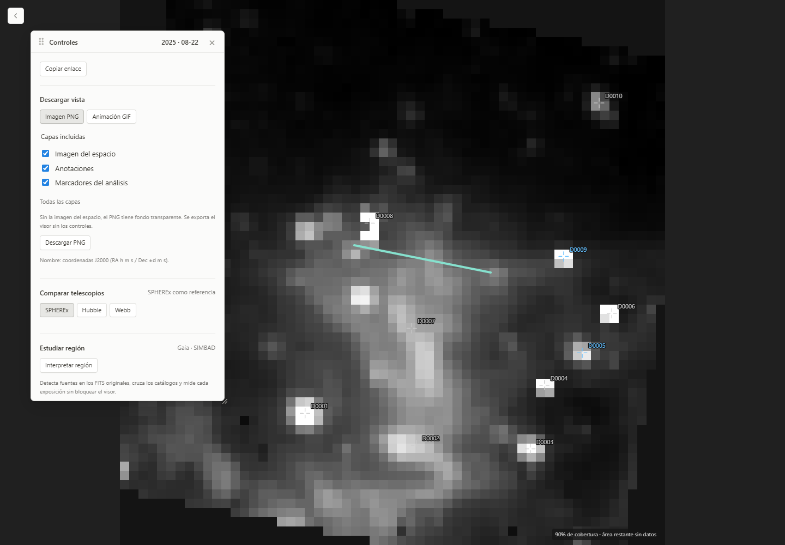

# Exportación PNG y GIF

Coordinación previa del cambio: App compondrá una herramienta de exportación en la ventana existente mediante un slot de ui. viewer expondrá captura visual PNG del visor y esperará a cuadros Canvas presentados; la captura Aladin usará su API pública desde el documento aislado. shared conservará ViewState en grados y añadirá únicamente opciones de capas y nombres sexagesimales seguros. La anotación SVG y las marcas se compondrán independientemente de las imágenes; no se modificará ningún FITS ni la API de coordenadas/Paint.

La exportación GIF será explícita y cancelable, con encoder abierto ejecutado en Worker y sin servicios externos. Usará exclusivamente fechas ya preparadas, ordenadas y con su fecha real; informará de cuadros pendientes/fallidos. La reproducción se pausará y se abrirán los cuadros preparados a través de la solicitud de fecha existente. Las imágenes serán obligatorias en GIF y opcionales en PNG. PNG conservará transparencia sin imágenes. El nombre incluirá centro ICRS/J2000 en RA h:m:s y Dec ±d:m:s; GIF añadirá el rango UTC exportado. Se coordina añadir gifenc como dependencia fijada y su licencia MIT.

## Uso

En la ventana de controles, abre **Descargar vista**. Selecciona **Imagen PNG** o **Animación GIF**, marca las capas deseadas y pulsa Descargar. **Todas las capas** activa espacio, anotaciones y marcadores. Los marcadores requieren un análisis previo; las detecciones corresponden a los píxeles y candidaturas ya explicados en el visor, no a un clasificador nuevo.

PNG exporta el área del visor sin menú, avisos ni tiradores de selección de Paint. Permite espacio, anotaciones y marcadores en cualquier combinación; sin espacio conserva transparencia RGBA. Respeta el borrado parcial, colores y posiciones. En pantalla dividida compone ambos paneles, y conserva el solapado de telescopios. Se captura Canvas 2D directamente; para HiPS/FITS de Aladin se usa su API pública `getViewData`, sin leer buffers WebGL internos.

GIF requiere una región animada con al menos dos cuadros preparados. El espacio permanece activo; anotaciones y marcadores son opcionales. Se exportan los cuadros preparados en orden cronológico, con su fecha SPHEREx UTC visible y el intervalo de reproducción elegido. Las fechas pendientes o fallidas se muestran como tales y no se inventan ni sustituyen. El conjunto exportable se fija al empezar: descargas que terminen después quedan para una exportación posterior. La vista vuelve a la fecha original y permanece pausada al terminar o cancelar.

Los nombres usan el centro actual en la convención ICRS/J2000 del formulario, expresado como RA h:m:s y Dec ±d:m:s. Esto es presentación sexagesimal, no una nueva transformación astrométrica. Se evitan caracteres no válidos de Windows:

```
eon_J2000_RA04h03m14.64s_Dec+51d20m25.45s.png
eon_J2000_RA04h03m14.64s_Dec+51d20m25.45s_2025-08-22T003848Z--2026-09-02T103630Z.gif
```

## Rendimiento y límites

La exportación es local, sin subir imágenes o dibujos a un servicio. PNG conserva la imagen de pantalla sin pérdida, hasta 4096 px de lado, con un máximo de dos píxeles por píxel CSS. El GIF permite un lado máximo de 512, 768 o 1024 px, hasta 200 cuadros y 80 MB. No aumenta la resolución científica. GIF usa paleta de hasta 256 colores por cuadro; puede perder gradaciones respecto al PNG/FITS.

`gifenc` 1.0.3 (MIT) cuantiza y codifica en un Worker. Se transfiere y libera un cuadro RGBA a la vez: no se aloja toda la secuencia de capturas sin comprimir. Cancelar termina el Worker; no descarga un archivo incompleto. Fallos de captura/codificación se muestran y permiten reintentar. No hay peticiones FITS nuevas de la exportación; la preparación normal que ya estaba en curso puede continuar.

Las capturas son productos visuales. Los FITS y las mediciones científicas originales no se modifican. En una comparación, la fecha animada corresponde únicamente a SPHEREx; los mosaicos de archivo conservan sus épocas propias. La falta de cobertura sigue vacía.

## Comprobaciones

Las pruebas de navegador descargan archivos reales y los decodifican: transparencia, borrado parcial, marcadores independientes, PNG combinado, API Aladin, pantalla dividida, tres cuadros GIF distintos, duración y bucle, nombres, restauración de fecha, cancelación/reintento y ausencia de nuevas peticiones FITS. Los nombres también se prueban con RA cerca de 24 h y declinaciones negativas menores de un grado.

La entrega pasó 73 pruebas unitarias y 41 de navegador. `scripts/verify-exports.mjs` prueba un sitio compilado local (puerto 4174) o público (`EON_VERIFY_URL`) con el ejemplo real, bloqueando otros archivos externos. Descarga PNG y dos GIF, con todas las capas y solo espacio, y comprueba que no hay errores de página ni descargas FITS adicionales. Una inspección independiente con Pillow confirmó tres cuadros, duración elegida y bucle; las anotaciones aparecen en los tres cuadros y desaparecen al excluirlas. Los archivos de comprobación quedan en `output/exports/`, fuera de Git.


