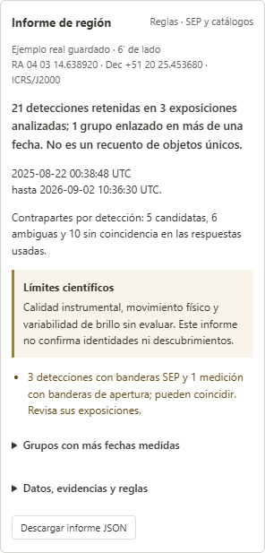

# Informe de región

En **Análisis → Interpretar región**, eon consulta catálogos y, si hay una secuencia regional activa, analiza sus IMAGE FITS con SEP. Al terminar aparece **Informe de región**. Resume las mediciones disponibles y explica cuáles no permiten una conclusión científica. No entrena un modelo, no usa un chatbot y no realiza llamadas a servicios de IA.

El motor de reglas versionado `eon-evidence-rules-1` funciona localmente con los resultados ya obtenidos. No descarga otra copia de las imágenes ni consulta un catálogo al reproducir cada fecha. El ejemplo NGC 1491 sigue siendo un conjunto real guardado que se abre solo explícitamente. Se identifica como tal; la lectura de sus tablas guardadas no se presenta como consulta en vivo.

## Reglas

| Regla                   | Evidencia y conclusión permitida                                                                                                                         |
| ----------------------- | -------------------------------------------------------------------------------------------------------------------------------------------------------- |
| `pixel-detections`      | Detecciones retenidas por exposición y parámetros de SEP. La suma entre fechas no es el número de objetos únicos.                                        |
| `positional-recurrence` | Grupos con mediciones en fechas UTC distintas. Dos detectores simultáneos no se cuentan como dos épocas temporales. No demuestra identidad o movimiento. |
| `counterparts`          | Asociaciones candidatas, ambiguas y ausencias en las respuestas consultadas, por detección. No establece un inventario completo del cielo.               |
| `catalog-entries`       | Filas recibidas de Gaia DR3 y SIMBAD; pueden representar al mismo objeto. No prueban detecciones SPHEREx.                                                |
| `sep-flags`             | Banderas SEP y de apertura, contadas por separado aunque coincidan. No diagnostica saturación instrumental.                                              |
| `partial-measurements`  | Fallos, omisiones, límites de detecciones y registros/enlaces incoherentes excluidos.                                                                    |
| `stale-input`           | Evita combinar otra región, dataset o consulta de catálogo. Comprueba ID, fecha y URL del recorte contra la secuencia activa.                            |

Los grupos se listan por fechas distintas y exposiciones medidas, no por probabilidad de descubrimiento. Al seleccionar uno se explica si sus contrapartes son consistentes, ambiguas o no resueltas y se puede abrir cada exposición. Para describir una candidatura consistente, todas sus mediciones deben proponer la misma contraparte única y disponer del contexto de catálogos sin fallos/truncamiento. Sigue sin ser una identidad confirmada. Contrapartes distintas o ambiguas se mantienen sin identificar.

Las clases y probabilidades pertenecen al catálogo. Gaia DSC no expresa la probabilidad de que el cruce sea correcto ni una precisión validada por eon. El umbral SEP en sigma es un parámetro de extracción, no una probabilidad de que la fuente sea real.

## Sin evaluar

El grupo seleccionado incluye una siguiente revisión concreta. Prioriza banderas de extracción/apertura; después, ambigüedad, catálogos incompletos y falta de otras fechas. Una candidatura consistente sigue requiriendo bandas compatibles y evaluación instrumental para cuantificar cambios. Las candidaturas por exposición aparecen en sus evidencias, con proveedor; no se sustituyen por una identidad elegida automáticamente.

- **Calidad instrumental:** no se incorporan FLAGS/VARIANCE instrumentales ni correcciones de PSF/apertura. Cero banderas SEP no significa datos instrumentalmente limpios. La fracción de píxeles válidos del recorte no mide cobertura completa de la región ni detecta saturación.
- **Movimiento físico:** la separación esférica entre primer y último centroide se presenta como separación angular, sin atribuirla a movimiento propio. No hay ajuste de trayectoria con incertidumbres instrumentales completas; las asociaciones pueden pertenecer a fuentes distintas.
- **Variabilidad y espectro:** falta la longitud de onda efectiva por fuente y la homogeneización espectral/PSF. Las señales no se convierten en curva de luz a banda fija ni en espectro.
- **Descubrimiento e identidad:** una ausencia de contraparte no anuncia un objeto nuevo. Una falta de detección no demuestra ausencia física; pueden influir cobertura, umbral, mezclas y límites.

Los mosaicos Hubble/Webb, los canales visuales HiPS y las anotaciones son contexto visual, no mediciones fotométricas de este informe.

## Evidencia y descarga

**Datos, evidencias y reglas** contiene fecha de consulta/lectura, parámetros, recuentos y exposiciones. **Ver exposición** pausa y abre el cuadro existente. Las referencias permiten descargar el IMAGE analizado o consultar el FITS de archivo de IRSA; nunca se descargan automáticamente. Solo se emiten enlaces a endpoints acotados del sitio y rutas oficiales permitidas, incluyendo los tres ejemplos conocidos.

**Descargar informe JSON** guarda método/versionado, región, fecha de exportación, estado de catálogos, observaciones, cautelas, límites, procedencia por exposición y referencias frame/detection de todos los grupos. Si hay un grupo seleccionado incluye sus mediciones y candidaturas. El nombre contiene el centro J2000 sexagesimal. Se conservan las exportaciones independientes de mediciones JSON/CSV existentes.

## Comprobaciones

El JSON conserva las entradas de catálogo utilizadas, incluyendo sus posiciones, época, clases y probabilidades publicadas cuando existen. Para describir una candidatura consistente también se comprueba que ID, nombre, proveedor, clase y probabilidad correspondan a esa consulta concreta. Un contexto de catálogos sin fallo/truncamiento no significa un inventario completo del cielo.

Las pruebas de reglas cubren duplicados, fechas simultáneas, cambios de URL/región/consulta, cruce RA=0, banderas solapadas, catálogo parcial, extracción vacía, enlaces permitidos, determinismo y conservación de entradas. Los casos unitarios controlados no son datos de producción ni una medición de precisión científica.

Las pruebas de navegador usan FITS y catálogos oficiales guardados. Contrastan el informe con 21 detecciones, 19 grupos y un grupo en tres fechas del ejemplo NGC 1491 a 5σ. Verifican JSON, navegación a evidencia, cero peticiones adicionales al revisar/exportar, catálogo sin píxeles, proveedor fallido, fecha FITS incorrecta y cancelación sin mezclar catálogos nuevos con píxeles anteriores. No se entrenó ni evaluó un clasificador nuevo.

Referencias: [espectrofotometría de IRSA](https://irsa.ipac.caltech.edu/onlinehelp/spherex/spherex/sp.html), [SEP](https://sep.readthedocs.io/en/stable/), [detección de eon](ANALISIS-PIXELES.md).

